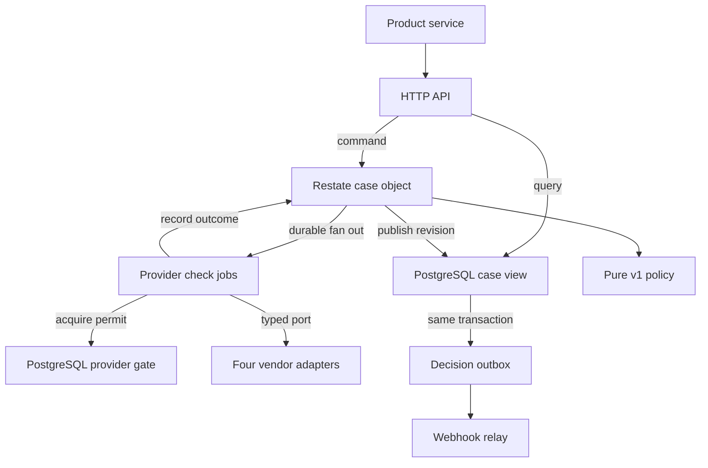

# eKYC service

An onboarding product needs an answer to a specific question: did this customer pass the checks required for this purpose, using this evidence, under this policy? The decision belongs to a verification case. An address refresh can approve only the address scope. Full onboarding requires document, face, address and sanctions checks.

This design uses a Rust workspace, one Restate virtual object per case, independent durable check invocations, and a PostgreSQL query model. Slow vendors can retry without holding the case's execution lock. Callers can continue reading the last published case revision during those retries.

## Requirements and policy

The supplied eKYC decision and service-client specifications define the four checks, three decision outcomes and versioned reasons. Their production checklist adds external configuration, observability, transport limits, asynchronous delivery, privacy and persistent audit. The sample’s v1 decision rules are implemented below. The two named purposes, evaluation against the UTC decision date, and precedence for simultaneous findings are explicit service contracts.

| Check | Evidence in the problem space | v1 rule |
| --- | --- | --- |
| Document | Type, number, expiry and image | Expired → reject. Otherwise require provider pass and confidence >85. Other outcomes go to review. |
| Face | Selfie and ID portrait for the same subject | Require provider pass, confidence >85 and similarity >85. At either threshold, send to review. |
| Address | Claimed address, proof type, proof date and image | Require provider pass, confidence >80 and proof 0–90 days old, inclusive. Future-dated or stale proof goes to review. |
| Sanctions | Full name, date of birth and nationality | Clear passes. A hit rejects. An unsuccessful screen also rejects under v1, with a separate reason from a hit. |

An ID is valid through its expiry date. Each provider must use an agreed score scale. The policy rejects early on any hard rejection and otherwise waits for all planned checks. Missing evidence is a recorded finding. A missing entry for an outstanding check means pending. A hard rejection can leave other checks skipped. This prevents empty or partial evidence from producing full approval.

The local contract accepts an opaque evidence reference per check. Four independent mock vendors resolve those references into synthetic findings. A real deployment needs an evidence service that binds a versioned document or capture to the subject and authorizes its release to the selected vendor. Human review assignment and adjudication belong to the consuming operations system.

## Architecture and dependency boundaries

The API maps HTTP into commands and reads. The Restate adapter drives the case lifecycle and composes the concrete provider implementations at startup. Its provider registry uses a small domain-owned vocabulary and the application’s `Provider` port. The Rust domain can evaluate a case with no network, database, wall clock or Restate dependency.

Each provider crate owns a different payload and decoder. The document adapter interprets status, confidence and expiry. The face adapter preserves decimal similarity separately from confidence. The address adapter parses the date on the proof. The screening adapter checks status against match count and maps clear and hit explicitly. A provider can change authentication, codec or endpoint without editing the others. Shared HTTP transport knows nothing about a face, address or sanction.

## Commands and queries

| Path | Owner | Contract |
| --- | --- | --- |
| `POST /v1/cases` | API → Restate `VerificationCase.open` | Authenticate and validate scope. Hash the caller's idempotency key into a caller-scoped case ID. The first command pins inputs, purpose, policy and deadline. An exact replay returns the same ID. A different normalized command using the same key returns 409. |
| `ProviderChecks.run` | Restate service | One private invocation per supplied, in-scope check. Acquire a vendor permit, perform the HTTP operation, and report one normalized finding. Provider jobs for one case can run concurrently. |
| `VerificationCase.record / expire` | Keyed case object | Exclusive handlers serialize competing findings and the deadline. Select facts, evaluate v1 and advance the revision. A late result cannot reverse a terminal decision. |
| `GET /v1/cases/{id}` | API → PostgreSQL | Read the caller's projection. Include purpose, scope, per-check outcomes, decision, reasons, revision and policy version. An ID owned by another caller returns 404. |
| `ekyc.case.decided.v1` | PostgreSQL outbox → webhook relay | Publish one logical terminal event. The recipient deduplicates the stable event ID and can fetch the complete case from the authorized API. |

The write model is Restate object state. The read model is PostgreSQL. Publishing a revision runs as a journaled, retryable external step. A single SQL transaction updates the current view, appends its revision and creates the terminal outbox entry. A version guard tolerates replay after a SQL commit and prevents an old update from overwriting a newer or terminal view. The repair handler can republish the current case revision from Restate after a read-model loss. Recover historical revisions from a PostgreSQL backup. The API acknowledges admission after the initial projection succeeds. If a command times out at ingress, the caller retries the same key. While publication is impaired, reads can show the previous revision.

Recovery relies on a stable handler contract and pinned policy version. Deploy new worker versions at distinct endpoints and retire old versions after their invocations finish. Preserve a compatible evaluator for open cases created under an older policy. Future policy experiments need a stored variant assignment, rule snapshot and approval history. The runnable slice ships one v1 evaluator. [Restate service versioning](https://docs.restate.dev/services/versioning)

## Failure handling and limits

| Failure or pressure | Enforced behavior |
| --- | --- |
| Client traffic spike | PostgreSQL counts authenticated submissions per caller per UTC clock minute, including retries. Return 429 with a rounded-up `Retry-After`. Reads bypass the submission quota. A fixed minute boundary can admit two windows' traffic in a short burst. |
| Vendor request budget | A row lock serializes grants for each vendor. Count granted leases in a sliding 60-second interval. The maximum in-flight limit is separate. Limits apply across worker replicas sharing this database. A worker releases the DB connection before network I/O. |
| Timeout or uncertain outcome | The HTTP client has connection and whole-call timeouts, bounds response size, and disables implicit redirects and HTTP retries. Each check uses a stable provider operation ID across attempts. A separate lease token identifies each attempted dispatch. |
| 429 or retryable server failure | Classify the response and preserve `Retry-After`. Restate sleeps durably for the delay. Retryable failures get bounded exponential backoff with jitter. The shared gate respects vendor cooldown. A permit wait consumes time in the case budget and does not consume an HTTP attempt. |
| Sustained vendor failure | A per-provider circuit opens on consecutive transient failures. After cooldown, permit a single half-open probe. Fenced lease completion prevents an old response from closing a newer circuit. The other three providers have independent limits. |
| Worker death | Restate resumes uncompleted invocations. An ambiguous attempt waits out its lease before a new attempt gets a permit. Vendor idempotency lets the later HTTP call recover the original logical operation. This requires a documented vendor guarantee in production. |
| Deadline or exhausted attempts | Use whichever boundary arrives first. Unavailable noncritical evidence goes to review. v1 rejects an unavailable sanctions screen with `SANCTIONS_UNAVAILABLE`. A positive screen uses `SANCTIONS_HIT`. Infrastructure outages may delay when the decision becomes visible. |
| Webhook outage or relay crash | Claim a due event with a finite lease, send outside the database transaction, and acknowledge with the claim fence. An ambiguous delivery may be repeated. The local recipient stores event IDs durably and treats repeats as acknowledgments. |

Every component uses external configuration. Local defaults are three vendor attempts, a 2.5-second HTTP timeout, a 30-second case deadline, 60 grants per vendor per sliding minute, and four in-flight calls per vendor. The breaker opens after three consecutive transient failures and probes after five seconds. `FACE_PER_MINUTE` or `SANCTIONS_MAX_IN_FLIGHT`, for example, override one provider independently. Treat the numbers as demo settings until the supplier quota, response distribution and product deadline are known.

Restate owns scheduling, replay and timers. PostgreSQL owns quotas shared between concurrent jobs and atomic query/audit/outbox writes. Adding an independent SQL job queue would introduce a second owner for the same work. [Restate Rust SDK](https://docs.rs/restate-sdk/latest/restate_sdk/) · [Restate HTTP invocation](https://docs.restate.dev/services/invocation/http)

## Records, operations and production boundary

- **Case state and history.** Restate stores normalized commands, evidence references and case state. PostgreSQL stores the current projection and immutable published revisions. A terminal event has one deterministic ID per case revision. Back up Restate and PostgreSQL, retain pinned policy versions, and test projection repair against the recovery objectives of the first product.
- **Provider limits.** Lease records are both rate-window inputs and replay fences. Retain token tombstones beyond the supported replay window. Monitor age and growth and choose cleanup rules before enabling high traffic. The current SQL gate serializes briefly on one row per vendor. Measure contention against actual quotas.
- **Local observability.** The API exposes liveness, database readiness and Prometheus-format admission, quota, read and dependency-error counters. Use Restate's deployment and invocation views to inspect retries. SQL shows open cases, outstanding webhook deliveries, attempts and breaker state. Monitor deadline breaches, old undelivered events and the rate of `SANCTIONS_UNAVAILABLE` independently of sanctions hits.
- **Privacy and access.** Local API tokens are scoped to caller and purpose. Commands, journal entries and projections contain sensitive metadata even where they hold opaque references. Production requires service identity, private Restate administration and ingress, protected evidence storage, controlled audit access, managed secrets, encryption, deletion and retention policies. The demo webhook is a single configured internal recipient. A multi-tenant product needs authorized subscriptions and credentials per destination.
- **Policy ownership.** Risk owners choose mandatory checks, treatment of unsuccessful screening, vendor score calibration and manual-review handoff. Changing a threshold requires a new policy version. Configurable policy authoring, A/B assignment and a warehouse sink are subsequent increments.
- **Availability.** The local deployment has one Restate node and one PostgreSQL instance. Configure replication, backups and restore tests, vendor authentication and reconciliation for suppliers without idempotency before live onboarding. Set production throughput, latency and availability targets after load testing against real vendor limits.

## Acceptance

The runnable path covers approval, review at the face threshold, expired ID, sanctions hit, recovery after provider throttling, a lost provider response, terminal sanctions outage, idempotent HTTP replay and payload conflict, cross-caller isolation, and webhook receipt. SQL tests cover concurrent case publication, quotas, circuit recovery and expired lease fencing. The Linux recovery exercise kills a disposable worker while a mock has accepted a verification, restarts it, and checks that the case still produces one terminal decision and one logical notification.

Requirements provenance: the two eKYC specifications and `IMPROVEMENTS.md` in the supplied sample, plus the prior eKYC service design. The repository README contains commands for reproducing each test.
